### ¡Hola a todos! Mi nombre es Leyder Ismalej - aka [Leyder5][github] 👋

[][website]

## Soy estudiante y desarrollador de Software en formación

- Estos son algunos de los cursos que estoy tomando:
- 👉[Curso de Git & GitHub](https://www.udemy.com/course/git-y-github-desde-cero-a-experto/)[][cursoGit&GitHub]!
- 👉[Curso Ultimate JavaScript](https://holamundo.io/)[][cursoJS]!

### Contactame!:

[][website]
[][linkedin]
 

### Lenguajes y Herramientas que utilizo:

__Generales:__
 

 

---
__Desarrollo Web:__
 

 

---
__Cursos:__
 

 

---

## 🔎 Mis estadisticas:

    
🔎 Ver

 

[website]: https://leyder5.github.io/portafolio/
[github]: https://github.com/Leyder5
[linkedin]: https://www.linkedin.com/in/leyder-ismalej-238aa4194
[cursoGit&GitHub]: https://www.udemy.com/course/git-y-github-desde-cero-a-experto/
[cursoJS]: https://holamundo.io/
